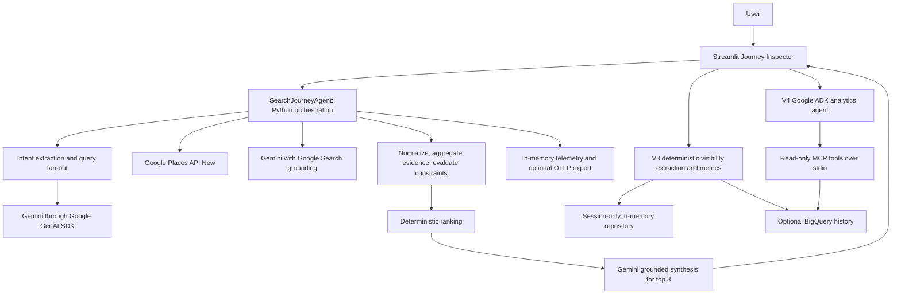
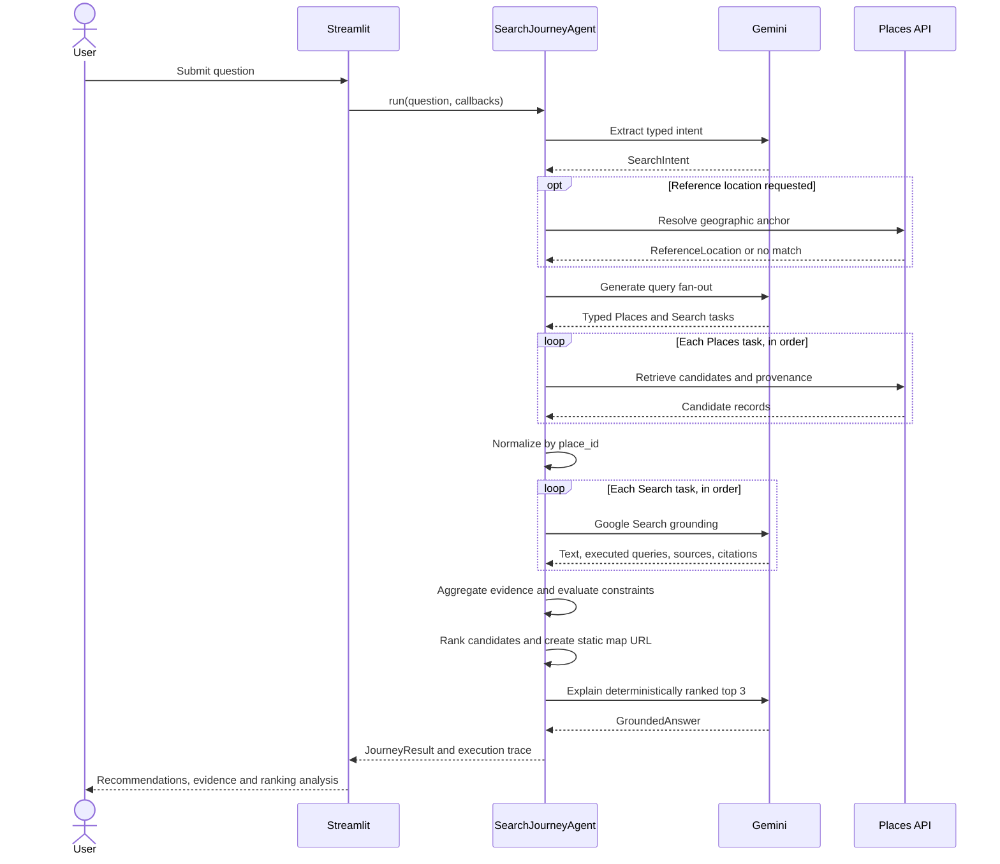

# Architecture

AI Search Journey Lab makes local discovery inspectable: a question becomes a
plan, retrieved places and web evidence, explicit constraint evaluations, and
ranked recommendations. The lab exposes how a business moves from a retrieval
position to a recommendation, and how its visibility changes across saved scans.
It is an educational application using public Google APIs, not an implementation
of Google's internal search or ranking systems.

This guide describes the current implementation. Start with the
[README](../README.md) for the demo and [CONTRIBUTING](../CONTRIBUTING.md) for setup
and verification commands.

## System map

V1's [`SearchJourneyAgent`](../src/ai_search_journey/adk/agent.py) is an explicit
Python orchestrator with ADK-style tool wrappers. It does not delegate the search
journey's control flow to the Google ADK runtime. V4's
[`VisibilityAnalyticsAgent`](../src/ai_search_journey/visibility/v4_agent.py)
does use Google ADK and an MCP toolset. The two paths have different dependencies
and storage requirements.

## Query lifecycle: V1 search to decision

[`app.py`](../src/ai_search_journey/app.py) collects the question and runs
`SearchJourneyAgent.run()`. Its callbacks update the visible execution timeline.
The returned `JourneyResult` is held in Streamlit session state for inspection
and subsequent visibility analysis.

The fan-out describes multiple retrieval tasks; execution currently awaits each
task sequentially within the Places and Search stages. It is not a concurrent
worker queue.

| Stage | Implementation and responsibility |
| --- | --- |
| Intent | [`planner.py`](../src/ai_search_journey/planner.py) asks Gemini for structured intent; Pydantic validates the application-facing model. |
| Reference location | [`places.py`](../src/ai_search_journey/places.py) resolves a geographic anchor when one is requested. |
| Fan-out | [`fanout.py`](../src/ai_search_journey/fanout.py) produces `FanoutQuery` tasks with a tool, goal, query and task ID. |
| Places retrieval | [`adk/tools.py`](../src/ai_search_journey/adk/tools.py) wraps Places retrieval; each candidate records its query and original retrieval position. |
| Normalization | [`normalize.py`](../src/ai_search_journey/normalize.py) merges candidates by `place_id` while retaining retrieval occurrences. |
| Search grounding | [`search.py`](../src/ai_search_journey/search.py) uses Gemini's Google Search tool and retains grounding metadata. |
| Evidence | [`evidence.py`](../src/ai_search_journey/evidence.py) associates structured Places and Search evidence with canonical candidates and preserves unmatched web evidence separately. |
| Constraints | [`constraints.py`](../src/ai_search_journey/constraints.py) evaluates candidate attributes against the user's hard constraints and preferences. |
| Ranking | [`ranking.py`](../src/ai_search_journey/ranking.py) computes scores, proximity and quality contributions, category eligibility and explainable rank movement. |
| Presentation | [`static_map.py`](../src/ai_search_journey/static_map.py) builds a map URL; [`answer.py`](../src/ai_search_journey/answer.py) requests and validates grounded prose for the ranked top three. |

The static map can be skipped when coordinates are unavailable. An answer-stage
failure is recorded in the trace while the agent still returns the other journey
data with `answer=None`. Earlier stage exceptions record the failed step and
propagate to the UI. Inspect both `is_complete` and `failed_step_key`: a completed
execution can still have a failed answer stage. The V3 runner rejects journeys
with a recorded failure rather than treating them as successful scans.

## What the model decides, and what Python decides

Gemini extracts intent, proposes retrieval queries, supplies web-grounded text,
and synthesizes the final explanation. These steps depend on model and external
service responses. Calling the later scoring deterministic does not make the
whole journey reproducible across live API calls.

Python owns candidate identity, evidence association, constraint evaluation,
scoring, ordering, distance calculations and visibility metrics. In particular:

- `SUPPORTED` means evidence supports the constraint.
- `NOT_SATISFIED` means evidence contradicts it.
- `UNKNOWN` means the available evidence does not settle it; it is not false.

[`ranking.py`](../src/ai_search_journey/ranking.py) applies separate weights to
hard constraints and preferences, with proximity and rating/review quality
contributions. Category eligibility also affects ordering. The answer generator
receives the already ranked candidates; it must preserve their identities and
order rather than invent or reorder venues. V2 exposes the factors and the
difference between the best Places retrieval position and final rank.

## Evidence and citations

The contracts are in [`models.py`](../src/ai_search_journey/models.py):

- `RetrievalOccurrence` records a Places query, task ID and one-based position.
  A candidate may have several occurrences after normalization.
- `SearchGroundingResult` distinguishes the application's `planner_query` from
  `executed_search_queries` reported by Google Search grounding. These are not
  interchangeable lists.
- `SearchSource` holds source URLs and titles. `SearchCitation` maps a text
  segment to source indices from that grounding result.
- `Evidence` carries a candidate ID, attribute, claim, source type and available
  task/query/citation provenance. `ConstraintSupport` preserves supporting or
  contradicting evidence in the evaluation matrix.

The UI can therefore show why a constraint received its status and which
retrieval task or source supported it. Missing sources remain missing evidence;
the presence of generated prose alone is not a verified citation. Source indices
must be interpreted against their own grounding response.

## V3: AI visibility and storage

The [V3 guide](v3-ai-visibility.md) covers the user workflow. The
[`extractor`](../src/ai_search_journey/visibility/extractor.py) derives brand,
fan-out and citation observations from an existing journey. The
[`runner`](../src/ai_search_journey/visibility/runner.py) validates a completed,
non-failed journey and consistent scan inputs, then saves a `VisibilityScanBundle`
through the [`VisibilityRepository`](../src/ai_search_journey/visibility/repository.py)
protocol. This extraction does not launch a second search journey.

[`metrics.py`](../src/ai_search_journey/visibility/metrics.py) computes mention,
recommendation and owned-citation rates, average recommendation position,
share of voice and fan-out coverage. The denominator for a brand's scan rates
includes only scans that track that brand. A zero-scan result has zero rates and
no average recommendation position; it does not establish a trend.

V3 defaults to an `InMemoryVisibilityRepository` held in Streamlit session state.
It requires no database and does not provide durable history. The optional
[`BigQueryVisibilityRepository`](../src/ai_search_journey/visibility/bigquery_repository.py)
implements persistent history using the schemas in
[`bigquery_schema.py`](../src/ai_search_journey/visibility/bigquery_schema.py).
The UI offers BigQuery history when its configuration and dependency are
available. Configuration lives in [`config.py`](../src/ai_search_journey/config.py):
`BIGQUERY_PROJECT`, `BIGQUERY_DATASET` and `BIGQUERY_LOCATION`.

## V4: read-only analytics agent

The [V4 guide](v4-ai-visibility-agent.md) describes the optional history agent.
`create_v4_agent()` starts an MCP server subprocess with the current Python
interpreter and connects through stdio. The ADK agent calls tools in
[`mcp_server.py`](../src/ai_search_journey/visibility/mcp_server.py); validated
requests and analytical queries live in
[`v4_analytics.py`](../src/ai_search_journey/visibility/v4_analytics.py).

This path reads BigQuery history. It does not use V3's Streamlit in-memory
repository as a fallback, write scans, or trigger Places searches. Its readiness
checks require a Gemini key and BigQuery configuration; the `v4-agent` and
`bigquery` extras supply the optional libraries. The agent instructions require
history discovery when brand or date bounds are missing, factual tool-derived
metrics, and an explicit warning when there is too little history for a trend.

## Observability

[`JourneyExecutionTrace`](../src/ai_search_journey/models.py) drives the UI's
step statuses, elapsed times and errors. The separate
[`telemetry`](../src/ai_search_journey/telemetry/) package provides OpenTelemetry
spans for journey stages, visibility scans and V4 tool calls. Its in-memory
`TelemetryStore` supports the local inspector without external infrastructure.
[`redaction.py`](../src/ai_search_journey/telemetry/redaction.py) sanitizes
telemetry values, URLs and errors before storage/export; this is not a claim
that every UI field or application log is redacted.

When `OTEL_EXPORTER_OTLP_ENDPOINT` is configured, the application can export
HTTP/JSON traces and metrics to the collector. The checked-in
[`collector configuration`](../observability/otel-collector/otel-collector-config.yaml)
routes traces to Tempo and exposes metrics for Prometheus. Grafana uses those
data sources and provisioned dashboards. Telemetry export failures are handled
without making the search workflow depend on collector availability.

See the [Dockerized Observability Guide](bonus-b-dockerized-observability.md)
for setup, ports and troubleshooting. The local stack's demo credentials and
anonymous Grafana viewer are development settings, not a production access policy.

## Deployment boundaries

| Mode | What runs and where state lives |
| --- | --- |
| Local | Streamlit runs the Python package. Journey and default V3 history stay in session memory; Google APIs remain external dependencies. |
| Local with observability | [`run_app_locally.py`](../scripts/run_app_locally.py) starts/checks the separate [`Compose observability stack`](../docker-compose.observability.yml), then launches Streamlit. Compose does not host the application itself. |
| Application container | The multi-stage [`Dockerfile`](../Dockerfile) installs the package with BigQuery/V4 extras, runs as a non-root user, exposes Streamlit on port 8080 and checks `/_stcore/health`. |
| Cloud Run | [`deploy_cloud_run.sh`](../scripts/deploy_cloud_run.sh) builds/pushes an image, deploys Cloud Run with a service account and Secret Manager references, optionally configures BigQuery IAM, and probes the Streamlit health endpoint. |

Container health checks establish that Streamlit responds; they do not prove
that Gemini, Maps or BigQuery credentials work. Session state is tied to the
running process/session, so restarting or scaling containers does not turn the
default history into persistent or shared storage. BigQuery is the explicit
history option. Cloud deployment and IAM changes remain operator actions; merely
reading this guide or running the local UI does not provision cloud resources.

### Kubernetes direction

There are no Kubernetes manifests or Helm charts in the current repository.
Kubernetes is a possible deployment direction, not an available deployment mode.
A future design would need to decide how to route Streamlit sessions, inject
secrets and cloud identity, expose health checks, export telemetry and preserve
history across replicas. The current Docker image and optional BigQuery backend
are starting points; they do not supply those cluster decisions automatically.

## Contributor navigation

For a change, follow the data contract from [`models.py`](../src/ai_search_journey/models.py)
through the owning stage and its tests in [`tests/`](../tests/). Search-to-decision
orchestration belongs in `adk/agent.py`; visibility derivation and persistence
belong in `visibility/`; telemetry infrastructure belongs in `telemetry/`.
Keep scoring/evidence logic independent of Streamlit rendering and optional
cloud history. The stage-specific guides provide presentation examples:
[V1](v1-search-to-decision.md), [V2](v2-journey-analysis.md),
[V3](v3-ai-visibility.md) and [V4](v4-ai-visibility-agent.md).
